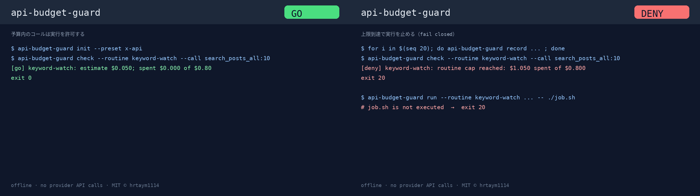

# api-budget-guard

[English](README.en.md)

`api-budget-guard` is a small offline CLI brake for scheduled agents that call metered APIs. It estimates a run before it happens, checks per-run, routine, and period (monthly or whole-phase) caps, records actual spend to a JSONL ledger, and can wrap commands so unattended jobs stop before touching a hard budget.

It uses only the Python standard library and never calls provider APIs.

## Install

```bash
pipx install git+https://github.com/hrtaym1114-github/api-budget-guard.git
```

For local development:

```bash
python3 -m venv .venv
.venv/bin/pip install -e ".[dev]"
```

## 30s Demo

[](docs/media/api-budget-guard-howto.gif)

- 🎞️ [GIF (GO ↔ DENY)](docs/media/api-budget-guard-howto.gif) · Release: [v0.1.0](https://github.com/hrtaym1114-github/api-budget-guard/releases/tag/v0.1.0)

```bash
api-budget-guard init --preset x-api
api-budget-guard check --routine keyword-watch --call search_posts_all:10
for i in $(seq 20); do
  api-budget-guard record --routine keyword-watch --tool search_posts_all --objects 10
done
api-budget-guard check --routine keyword-watch --call search_posts_all:10
api-budget-guard status
```

The first check is a go decision: `search_posts_all:10` costs `$0.05` against the example `keyword-watch` cap of `$0.80`. After the loop, the same check exits `20` because the routine cap is reached.

## Commands

```bash
api-budget-guard init [--preset generic|x-api]
api-budget-guard estimate --call TOOL:N[:owned]
api-budget-guard check --routine NAME --call TOOL:N[:owned] [--json]
api-budget-guard check --routine NAME --usd X [--json]
api-budget-guard record --routine NAME --tool TOOL --objects N [--owned] [--note TEXT]
api-budget-guard record --routine NAME --tool TOOL --usd X [--note TEXT]
api-budget-guard balance --usd X [--free X --paid X]
api-budget-guard status [--json]
api-budget-guard run --routine NAME --call TOOL:N[:owned] -- command arg...
```

`--call` can be repeated; the estimate is the sum of all calls. `check` requires `--call` or `--usd` (`--usd` wins if both are given); a bare `check --routine NAME` denies with exit `20`. `init` defaults to the `generic` preset and refuses to overwrite existing files. Amounts and counts must be non-negative numbers.

Global options:

```bash
api-budget-guard --config ./budget.json --ledger ./ledger.jsonl status
```

Defaults are `./budget.json` and `./ledger.jsonl`. Set `API_BUDGET_GUARD_NOW` to an ISO 8601 timestamp to evaluate as of that time (useful for tests).

## Exit Codes

- `0`: go
- `10`: degrade, run a smaller or cheaper path
- `20`: deny, fail closed

`run` returns the wrapped command's own exit code when the command fails.

`check --json` returns `allowed`, `level`, `reason`, and the routine's `cap`, `spent`, and `remaining` for the current period. It emits this complete shape even when no budget phase is active.

## Config Reference

The config file is JSON:

- `timezone`: IANA timezone used for phases and monthly periods.
- `pricing.event`: per-object prices.
- `pricing.request`: per-request prices.
- `tools`: maps tool names to `per_object`, `owned_per_object`, `per_request`, or `free`.
- `thresholds`: usage ratios for `warn`, `degrade`, and `stop`.
- `safety_margin_usd`: free-balance margin that must remain untouched (default `0`).
- `balance_max_age_hours`: balance snapshots older than this degrade checks (default `36`).
- `paid_baseline_usd`: paid or prepaid balance that should not drop.
- `paid_policy`: `stop` denies all calls once the paid baseline drops.
- `phases`: dated budget windows with `name`, `start`, `end` (end is exclusive), `period`, `cap_usd`, and `oneoff_approved_usd`.
- `phases[].period`: `month` resets caps each calendar month in `timezone`; any other value (such as `phase`) applies caps to the whole phase.
- `phases[].cap_usd` + `oneoff_approved_usd`: total cap for the period. The `oneoff-research` routine's period cap is `oneoff_approved_usd`.
- `phases[].routines`: per-routine `per_run_usd` and `period_usd` caps. A paid estimate for a routine not listed here is denied.

The bundled `x-api` preset contains example prices as of 2026-10. Verify prices with the provider before using it for real operations.

## Wrapper Mode

```bash
api-budget-guard run --routine keyword-watch --call search_posts_all:10 -- ./job.sh
```

The wrapper checks first. It runs the command only for exit `0` or `10`, exports `BUDGET_LEVEL=ok` or `BUDGET_LEVEL=degrade`, and records the estimate to the ledger after the command exits. If the command fails, its estimate is still recorded for fail-closed accounting and the command's exit code is returned.

## Fail-Closed Behavior

Missing or corrupt config and ledger files, malformed values in them, and invalid amounts exit `20`. Unknown tools, invalid call specs, inactive phases, per-run and routine cap overruns, period cap overruns, free-balance safety margin overruns, and paid-balance alarms also exit `20`.

A paid-balance alarm stays active until a later ledger row with `"kind": "ack-paid"` (and a `ts`) is appended.

## Non-Goals

- Calling provider APIs or scraping pricing.
- Dashboards, SaaS, billing integrations, or hosted storage.
- LLM features.
- Replacing provider billing alerts.

## 日本語メモ

`api-budget-guard` は、夜間や定期実行のエージェントが従量課金 API を使いすぎないためのローカル CLI です。設定ファイルの単価と上限だけで判定し、ネットワークには接続しません。`check` で実行前に止め、`record` で実績を JSONL に残し、`run` で既存ジョブを包めます。
